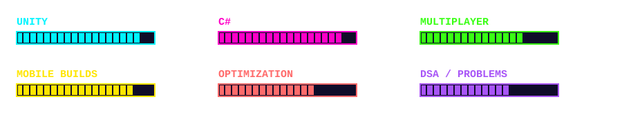

<div align="center">



<br/>

<a href="https://github.com/ashraful-shuvon"></a>


<br/><br/>


## 🕹️ PLAYER PROFILE

</div>

```yaml
Name:      Ashraful Shuvon
Class:     Unity Game Developer
Origin:    Bangladesh 🇧🇩
Primary:   C# / Unity
Platforms: Android, iOS
Skills:    Gameplay, UI, Multiplayer, Optimization
Co-op:     International clients & dev teams
Status:    ONLINE 🟢
```

I build interactive gameplay and ship games for mobile. From gameplay mechanics and UI systems to multiplayer features and performance optimization, I bring ideas to life one build at a time.

I also collaborate with international clients, communicate project requirements, coordinate development tasks, and work with teams to deliver quality game development solutions.

<div align="center">


## ⚔️ INVENTORY — TECH STACK

### 🎮 Game Engine & Languages


<sub>Unity • C# • Unity UI • Animator & Animation Systems • Cinemachine • URP</sub>

### 🌐 Multiplayer & Backend
<table align="center">
<tr>
<td align="center" width="25%"><b>🔗 Photon PUN</b></td>
<td align="center" width="25%"><b>☁️ PlayFab</b></td>
<td align="center" width="25%"><b>🔌 REST APIs</b></td>
<td align="center" width="25%"><b>🖥️ Client-Server Architecture</b></td>
</tr>
</table>

### 🧰 Tools & Workflow


<sub>Git & GitHub • GitHub Desktop • Figma • Visual Studio • Android Build & Deployment</sub>


## 📈 SKILL TREE




## 📊 GAME STATS


## 🎯 ACTIVE QUESTS

<table align="center">
<tr>
<td width="25%" align="center">

### 📱 Mobile
Building & improving Unity-based mobile games

</td>
<td width="25%" align="center">

### 🌐 Multiplayer
Exploring multiplayer development & networking

</td>
<td width="25%" align="center">

### 🏗️ Architecture
Improving gameplay architecture & C# skills

</td>
<td width="25%" align="center">

### ⚡ Performance
Optimizing games for mobile devices

</td>
</tr>
</table>

<sub>Side quest: leveling up on data structures, algorithms, and problem-solving.</sub>


## 🤝 JOIN MY PARTY

Always up for co-op with other developers, exciting projects, and new tech.

<br/>

<a href="https://github.com/ashraful-shuvon"></a>
<a href="https://linkedin.com/in/shuvonn"></a>
<a href="https://github.com/ashraful-shuvon?tab=repositories"></a>

<br/><br/>


<sub>▶ Build • Play • Test • Optimize • Ship • Repeat ◀</sub>

</div>
